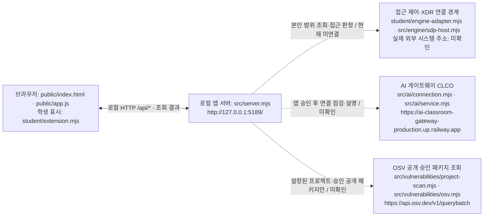

# 센티넬 학생용 실행 설명서와 시스템 구성도

작성일: 2026-10-23 · 21단계 학생 작성 문서

센티넬은 현재 계정·기기·세션, 업무 앱 접근 판정, 접속·XDR 기록, 참고용 AI 설명, 보안 조치 요청 상태, 설치 패키지의 OSV 조회 결과를 표시하는 보안 Agent입니다. 제공 화면의 제목과 실행 로그에는 아직 `케셰브`가 표시됩니다. 이 문서 작업에서 화면이나 제공 코드는 변경하지 않았습니다.

이 문서는 기존 README와 제공 안내를 보존하는 별도 학생 문서입니다. 확인 기준 학생 소스는 `91ea2feb5ac4605039d492d0538ae67cb82c158d`이며, 이번 문서 커밋에도 같은 학생 코드가 포함됩니다. 실제 외부 연동과 최종 환경 재현은 미완료이므로 v1.0 완료를 주장하지 않습니다.

## 1. 필요 프로그램과 확인한 버전

| 프로그램·환경 | 코드의 기준 또는 용도 | 이번 작업에서 실제 확인한 값 |
|---|---|---|
| Windows | `tools/start-alekov.ps1`로 실행 | `Microsoft Windows NT 10.0.26200.0`; 제품 에디션 미확인 |
| Node.js | `package.json`의 `engines.node`: `24.19.0`; 실행 도구 허용 범위: 22~24 | `v22.14.0`에서 기본 실행·재실행 확인. `24.19.0` 실행은 미확인 |
| Windows PowerShell | 아래 실행 명령의 `powershell` | `5.1.26100.9711`; `-NoProfile`의 새 프로세스에서 실행 |
| PowerShell | 문서 작성·명령 점검에 사용한 셸 | `7.6.5` |
| npm | `start`, `demo`, `check` 스크립트 실행 | `10.9.2` |
| Git | 저장소 위치·커밋 확인 | `2.51.0.windows.2` |
| 브라우저 | 로컬 HTTP 페이지와 JavaScript 표시 | Codex 내장 브라우저에서 초기 화면 확인. 브라우저 엔진 버전과 다른 브라우저는 미확인 |
| 앱 패키지 | `package.json`의 `name`·`version` | `alekov-client-starter` · `0.2.11` — 제품 완성도나 단계 통과 버전이 아님 |

Node.js 설치는 제공 README가 안내하는 [공식 배포처](https://nodejs.org/)를 사용합니다. 이 작업에서는 프로그램을 설치·업데이트하지 않았습니다. 이 앱의 `package.json`에는 외부 npm 의존성이 없으므로 기본 실행을 위해 `npm install`이나 `npm ci`를 실행하지 않습니다. 현재 저장소에는 `package-lock.json`과 `node_modules`가 없습니다. 다른 프로젝트의 OSV 조회 설정은 별도입니다.

## 2. 실제 작업 위치와 폴더 구조

저장소: <https://github.com/gyeonggumun/Sentinel-Defense-Battle>

이번 작업의 Git 최상위 폴더이자 앱 실행 폴더는 다음과 같습니다. 제공 문서의 `on-client` 예시와 달리 이 체크아웃에는 별도 `on-client` 하위 폴더가 없습니다.

```text
C:\Users\rudrn\OneDrive\Documents\ChatGPT\SKT 알래프\Sentinel-Defense-Battle
├── package.json                     실행 명령·Node.js 기준
├── .env.example                     비밀 없는 설정 견본
├── README.md                        제공 안내, 변경하지 않음
├── student/
│   ├── extension.mjs                 createStudentView와 학생 표시 함수 8개
│   └── engine-adapter.mjs            본인 범위 호스트 기능 연결; 기본 disconnected
├── public/
│   ├── index.html                   제공 화면·버튼
│   ├── app.js                       요청·상태 관리·학생 함수 호출
│   └── vulnerabilities-view.mjs      제공 OSV 응답 검사·표시
├── src/
│   ├── server.mjs                   127.0.0.1의 HTTP 서버
│   ├── engine.mjs                   연결 어댑터 로드·예제 엔진
│   ├── engine/                      SDP 호스트 연결
│   ├── ai/                          AI 게이트웨이 연결·응답 검사
│   ├── connection/                  계정·앱 연결과 자격 보관 경계
│   ├── actions/                     제공 서버의 조치 처리
│   └── vulnerabilities/             설치 메타데이터 대조·승인 패키지 OSV 조회
├── tools/start-alekov.ps1            제공 실행 도구
├── vendor/                          제공 번들
└── docs/STUDENT_RUNBOOK.md           이 학생 문서
```

새 PowerShell 창에서 아래를 실행합니다. 다른 PC에서는 `Set-Location`의 경로만 그 PC에서 실제로 받은 저장소 폴더로 바꿉니다. 기존 폴더에 재복제하거나 파일을 덮어쓰지 않습니다.

```powershell
Set-Location -LiteralPath 'C:\Users\rudrn\OneDrive\Documents\ChatGPT\SKT 알래프\Sentinel-Defense-Battle'
Get-Location
git rev-parse --show-toplevel
Test-Path -LiteralPath .\package.json
Test-Path -LiteralPath .\src\server.mjs
Test-Path -LiteralPath .\tools\start-alekov.ps1
node --version
npm --version
```

Git 최상위 폴더가 위 저장소이고 세 `Test-Path`가 모두 `True`인지 확인합니다. 상위의 `SKT 알래프` 폴더도 별도 Git 저장소이므로 그 위치에서 실행·커밋하지 않습니다.

## 3. 실행·브라우저 확인·종료·재실행

### 기본 실행

위 앱 폴더에서 실행합니다.

```powershell
powershell -NoProfile -ExecutionPolicy Bypass -File .\tools\start-alekov.ps1
```

실행 도구는 폴더·Node.js·포트를 확인하고 `src/server.mjs`를 실행합니다. `-ExecutionPolicy Bypass`는 이 프로세스에만 적용됩니다. 다른 프로세스를 종료하거나 시스템 실행 정책을 변경하지 않습니다.

이번 실행에서 다음 신호를 확인했습니다.

```text
참고: 지금 Node.js 는 v22.14.0 입니다. 수업 기준은 v24.19.0 입니다.
케셰브 연결 확인: http://127.0.0.1:5189
케셰브가 켜졌습니다. 브라우저에서 http://127.0.0.1:5189/ 을 여세요.
서버가 응답한 것만 확인했습니다. AI 연결 상태는 화면에서 따로 확인해 주세요.
끄려면 이 창에서 Ctrl+C 를 누르세요.
```

Node.js 22.14.0에서는 SQLite의 `ExperimentalWarning`도 출력됐지만, 이번 실행에서는 그 뒤에 서버의 준비 확인이 이어졌습니다. 경고만으로 시작 성공을 판단하지 않고 URL 응답과 화면을 함께 확인합니다.

브라우저에서 <http://127.0.0.1:5189/>를 엽니다. 이번에 실제 확인한 화면은 제목 `케셰브 · ZTNA & XDR`, 「보호 현황」, `연결 없음`, 학생 칸의 `ENGINE_NOT_CONNECTED`, 패키지 조회 칸의 `아직 조회 전(idle)`입니다. 기본 연결 어댑터가 비활성화되어 있으므로 연결 오류 표시는 실제 SDP·XDR 연결 성공을 의미하지 않습니다. 로그의 `연결 확인`도 서버 시작 문구입니다.

### 종료하고 다시 실행

1. 실행한 PowerShell 창에서 `Ctrl+C`를 누릅니다. 브라우저 탭을 닫는 것만으로 서버가 종료되지는 않습니다.
2. 새로고침했을 때 로컬 주소의 응답이 중단됐는지 확인합니다. 이번 작업에서는 `Ctrl+C` 후 HTTP 연결 실패를 확인했습니다.
3. 같은 앱 폴더에서 기본 실행 명령을 다시 실행하고 주소를 새로고침합니다.

동일 서버를 실행하는 대체 명령도 있습니다. 이번에는 종료 후 아래 명령을 새 PowerShell 프로세스에서 실행하고, 브라우저 새로고침으로 초기 화면의 재표시를 확인했습니다.

```powershell
npm start
```

`npm start`는 `node src/server.mjs`를 실행하며 실행 도구의 사전 버전·포트 검사는 수행하지 않습니다. 두 명령을 같은 포트에서 동시에 실행하지 않습니다.

### 다른 제공 명령

| 명령 | 용도 | 확인 범위 |
|---|---|---|
| `npm run check` | `node --check student/extension.mjs` | 이번 작업에서 종료 코드 0 확인. 문법 검사이며 기능·연동 검사가 아님 |
| `npm run demo` | `node src/server.mjs --demo` | 코드로 명령 확인. 이번 작업에서는 실행하지 않음. 예제 자료이며 실제 연결 성공이 아님 |
| `powershell -NoProfile -ExecutionPolicy Bypass -File .\tools\start-alekov.ps1 -Port 5190` | 기본 포트가 사용 중일 때 다른 포트 사용 | 코드로 옵션 확인. 실행 미확인. 이 경우 브라우저 주소는 `http://127.0.0.1:5190/` |

## 4. 글로 쓴 시스템 구성도

아래의 외부 연결선은 코드의 역할을 나타내며 연결 성공의 증거가 아닙니다.



| 경로 | 실제 코드·역할 | 이번 확인 |
|---|---|---|
| 브라우저 → 로컬 앱 서버 → 학생 표시 | 서버가 `public/index.html`·`public/app.js`·`student/extension.mjs`를 제공. `public/app.js`의 `studentData` → `createStudentView`의 해당 함수 → 반환 DOM으로 학생 칸 교체 | 기본 화면의 연결 없음·조회 전 표시를 실제 브라우저에서 확인 |
| 로컬 서버 → 접근 제어·XDR | `src/engine.mjs`가 어댑터 선택. `student/engine-adapter.mjs`는 호스트가 제공한 본인 범위 조회·접근 판정을 전달. 실제 SDP 호스트는 `src/engine/sdp-host.mjs`와 별도 개인 설정을 사용 | 기본 `disconnected` 확인. 실제 시스템 주소·사용자 매핑·XDR 조회는 미확인 |
| 로컬 서버 → CLCO | `src/ai/connection.mjs`에 공개 게이트웨이 주소가 있고, 앱 API 경로는 `/api/apps/aleph-on/v1`. `src/connection/`·`src/ai/`가 연결·자격·응답 검사를 담당 | 코드만 확인. 계정 승인·모델 연결·유료 AI 설명 요청은 실행하지 않음 |
| 로컬 서버 → OSV | 프로젝트 `package-lock.json`과 설치된 `node_modules` 메타데이터를 대조하고 승인된 공개 패키지의 정확한 버전만 조회. `public/vulnerabilities-view.mjs`가 응답 검사 후 학생 함수에 전달 | 코드만 확인. 현재 체크아웃에 잠금 파일·설치 목록이 없어 실제 버전 대조·외부 조회는 미확인 |

접근 제어·XDR 시스템이 AI 게이트웨이를 직접 호출하는 직렬 구조가 아닙니다. 로컬 앱 서버가 각각의 연결 경계를 가집니다. 브라우저 학생 함수는 AI 키를 받지 않으며 직접 집행하지 않습니다. ALEPH 과제 제출 화면과 로컬 실행 앱도 별개입니다.

## 5. 학생 구현 함수와 제공 코드 경계

`student/extension.mjs`의 `createStudentView()`가 반환하는 함수는 아래와 같습니다. 표의 입력은 현재 함수 선언에서 확인했습니다. 표시 함수의 존재가 실제 외부 시스템 연결 성공을 뜻하지는 않습니다.

| 학생 함수 | 받는 입력 | 학생이 구현한 표시·동작 |
|---|---|---|
| `renderIdentity` | `{ me, devices, sessions }` | 계정·기기·세션의 자료·요청 상태·연결 실패를 구분. 메뉴의 Tab·Shift+Tab 이동 처리 |
| `renderDecision` | `{ status, mode, data, error, appId }` | 선택한 업무 앱의 접근 판정·사유·시각·실패 표시. 화면 표시가 서버 판정을 바꾸지는 않음 |
| `renderEvents` | `{ status, mode, data, error }` | 기록 종류·업무 앱·접속 상태 필터, 선택 기록의 사건·근거·규칙·현재 상태 표시 |
| `renderStatus` | `{ devices, sessions, notifications, diagnostics, mode }` | 기기·현재 연결·주의 알림·도움정보 표시. 복사 가능 여부와 확인 불가를 구분 |
| `renderAiConnection` | `{ status, mode, data, error, checkedAt, explanationAccepted }` | 연결 점검·모델 목록·오류·시각 표시. 연결 점검을 실제 사건 설명 성공으로 표시하지 않음 |
| `renderExplanation` | `{ event, explanation, checkedAt }` | 사건 ID·참고용 요약, 현재 기록과 대조한 근거 ID·문장, 규칙, unknown, 제안 미실행 표시. 불일치 설명 거부 |
| `renderAction` | `{ status, event, actionId, target, receipt, observation, message, confirmationExpiresAt, error }` | 준비·사람 확인·전송·ACK·효과 관측을 구분. `succeeded`이면서 `effectApplied === true`일 때만 효과 확인. 실제 요청 버튼·티켓 처리는 추가하지 않음 |
| `renderVulnerabilities` | `{ status, mode, data, error }` | 정확한 버전·OSV 출처·시각·취약점 ID·수정 시각, 미조회·부분 실패 표시. 오류의 전달된 `error.message`를 텍스트로 표시하고, 메시지가 없으면 기존 안내 사용 |

| 영역·현재 파일 | 담당 역할 | 이번 21단계 변경 |
|---|---|---|
| 학생 화면: `student/extension.mjs` | 위 표시 함수와 관련 DOM·필터·키보드 처리 | 변경 없음 |
| 연결 지점: `student/engine-adapter.mjs` | 제공된 호스트 기능을 본인 범위로 전달하는 시작 틀. 운영자 권한·키 발급 기능이 아님 | 변경 없음 |
| 제공 UI: `public/index.html`, `public/app.js`, `public/vulnerabilities-view.mjs` | 필수 버튼·요청·응답 검사·취소·세대 번호·DOM 교체 | 변경 없음 |
| 제공 서버: `src/server.mjs`, `src/engine/`, `src/ai/`, `src/actions/`, `src/connection/`, `src/vulnerabilities/` | API·권한 경계·자격 보관·연동·조회 검증 | 변경 없음 |
| 제공 실행·안내: `tools/start-alekov.ps1`, `package.json`, `.env.example`, `README.md`, 기존 `docs/` 문서 | 실행 계약·설정 견본·과제 안내 | 변경 없음 |
| 학생 문서: `docs/STUDENT_RUNBOOK.md` | 실제 위치·실행 순서·글 구성도·확인 범위 | 새로 작성 |

원본 목록은 `.on-starter-manifest.json`의 `sourceHashes`에서 확인할 수 있습니다. 이 매니페스트에는 학생 파일의 시작 틀도 포함되며, 목록에 있다는 이유만으로 학생 성과가 인정되는 것은 아닙니다. 이번 문서 작업은 이 매니페스트도 변경하지 않습니다.

## 6. 장애별 확인 순서와 복구

| 실제 문구·상태 | 확인 순서 | 복구·다음 동작 |
|---|---|---|
| `Node.js 가 없습니다` 또는 버전 범위 거절 | `node --version` → 새 PowerShell의 PATH → 1절의 기준 버전 | 담당 안내에 맞는 Node.js 준비 후 새 창에서 재실행. 이번 작업에서는 설치하지 않음 |
| `앱 폴더가 아닙니다`·`시작 틀 폴더가 아닙니다` | `Get-Location` → 2절의 세 파일 → `package.json` 이름 | 실제 앱 폴더로 이동. 다른 폴더의 파일을 복사해 덮어쓰지 않음 |
| `포트 5189 를 다른 프로그램이 쓰고 있습니다`·`EADDRINUSE` | 기존에 앱을 실행한 창이 있는지 먼저 확인 | 본인이 시작한 앱만 해당 창에서 종료하거나 실행 도구의 사용하지 않는 `-Port` 선택. 다른 프로그램 일괄 종료 금지 |
| `앱 서버가 20 초 안에 뜨지 않았습니다` | 서버 시작 로그 → 해당 URL 응답 → 제한된 실행 환경의 로컬 통신 허용 여부 | 이번 샌드박스 실행은 시간 초과, 같은 명령의 일반 로컬 실행은 정상. 허용된 로컬 PowerShell에서 확인하고 지속되면 담당자에게 비밀 없는 로그 전달 |
| `연결 없음`·`ENGINE_NOT_CONNECTED` | 서버 시작 여부 → 기본 어댑터가 `disconnected`인지 → 담당자의 실제 연결 준비 여부 | 서버가 켜졌다는 것과 연동을 구분. 담당자 설정 준비 후 「다시 불러오기」. 학생이 임의 신원·가짜 성공을 만들지 않음 |
| `ENGINE_ADAPTER_INVALID` | 실제 사용 중인 연결 설정·어댑터 계약을 담당자와 확인 | 기존 어댑터·자격을 덮어쓰지 말고 올바른 호스트 연결 준비 후 재실행 |
| `ON_AI_PROVISIONING_PENDING`·`SUBJECT_SCOPE_UNVERIFIED` | 현재 계정·학생·프로젝트의 연결 → 앱 사용 승인 상태 | 담당자의 계정·권한 준비를 기다림. 「AI 연결 점검」 반복으로 권한을 만들 수 없음 |
| `WB_CLCO_AUTH_REQUIRED`·`WB_CLCO_ACCESS_BLOCKED`·사용량 제한 | 화면의 오류 코드·메시지 → 담당자의 승인·한도 상태 | 키를 채팅에 복사하지 않고 기존 제공 연결 절차와 담당자 안내 사용. 유료 요청 반복 금지 |
| `not_configured` / `PROJECT_NOT_CONFIGURED` | 조회 대상 프로젝트가 운영자에 의해 준비됐는지 확인 | 학생이 대상 경로나 허용 패키지를 임의 변경하지 않음. 설정 준비 후 「설치 패키지 조회」 |
| `not_checked` / `NO_APPROVED_PACKAGES` | 승인된 공개 조회 대상 유무 | 미조회 상태로 유지. 알려진 항목 없음으로 표시하거나 비공개 이름을 외부로 보내지 않음 |
| 전체 `unverifiable` / `LOCKFILE_UNVERIFIABLE` | 담당자가 지정한 프로젝트의 잠금 파일·설치 메타데이터 확인 가능 여부 | 정확한 버전을 확인할 수 있게 준비한 뒤 직접 재조회. 버전 범위를 설치 버전으로 대체하지 않음 |
| `partial` 또는 패키지 `unverifiable` | 받은 취약점 ID·수정 시각 보존 여부 → 미확인 패키지 구분 | 이미 확인된 항목을 지우지 않고 실패 부분은 확인 불가로 남김. 필요할 때 직접 재조회 |
| 패키지 `none_found` | 정확한 버전·출처·조회 시각·범위 확인 | 그 범위에서 알려진 항목 없음. 앱 전체가 안전하다고 판단하지 않음 |
| 조회 실패·`TIMEOUT`·`CANCELLED`·`CONTRACT_MISMATCH` | 학생 칸의 전달 메시지 → 이전 표가 사라졌는지 → 현재 요청 상태 | 「패키지 조회 취소」 후 필요한 경우 「설치 패키지 조회」로 새 요청. 취소·세대 번호 차단은 제공 `public/app.js` 담당 |
| 조치 `unknown`·`ACTION_TIMEOUT` | 현재 사건·대상·requestId·receiptId → 결과가 실제 관측됐는지 | 성공·효과 없음으로 단정하지 않음. 추가 집행 대신 제공 「원천 결과만 재조회」 사용 |
| 조치 `prepared`·`pending`·`expired` | 실제 대상·확인 기한 → 준비와 ACK와 효과를 구분 | 준비는 미실행, ACK는 접수. 기한 경과 시 다시 준비. 「조치 화면 취소」는 이미 전달된 효과를 되돌리지 않음 |

실제 화면의 버튼 이름은 「다시 불러오기」, 「도움정보 불러오기」, 「AI 연결 점검」, 「설치 패키지 조회」, 「패키지 조회 취소」, 「대상과 조치를 확인했으며 집행합니다」, 「원천 결과만 재조회」, 「조치 화면 취소」입니다. 실제 집행을 시험 삼아 요청하지 않습니다.

## 7. 확인 결과와 기다림(UNV)

| 항목 | 확인 방법 | 결과·한계 |
|---|---|---|
| 작업 위치·실행 파일·명령·설정 견본·버튼 이름 | Git·파일·소스 대조 | 코드 확인. `on-client` 하위 폴더를 전제로 하지 않음 |
| 제공 실행 도구의 기본 실행 | 새 Windows PowerShell 프로세스에서 실제 실행 | 로컬 실행에서 HTTP 준비 확인 성공. 최초 샌드박스 시도는 20초 시간 초과 |
| 기본 화면 | 실제 브라우저 | 「보호 현황」, `연결 없음`, `ENGINE_NOT_CONNECTED`, 학생 패키지 `idle` 확인 |
| 종료 | 실행 세션에 `Ctrl+C` 전달 후 로컬 URL 응답 확인 | HTTP 연결 실패로 종료 확인 |
| 재실행 | 새 Windows PowerShell 프로세스에서 `npm start`, 브라우저 새로고침 | 초기 화면 재표시 확인 |
| 문법 검사 | 실제 `npm run check` | 종료 코드 0. 기능·보안 연동 판정이 아님 |
| AI 설명·조치 상태·OSV 표시 | 앞 단계에서 DOM 대역과 모의 입력 사용 | 설명 16개, 조치 19개, 오류 메시지 수정 후 패키지 조회 23개 모의 검사 통과 기록. 실제 AI·집행·OSV 성공의 증거가 아님 |
| 모의 검사 재현성 | 검사 파일 위치·커밋 범위 구분 | 당시 로컬 임시 검사 파일은 저장소 밖에 있으며 제출 커밋에 포함되지 않음. 새 PC에서 이 검사를 그대로 재현하는 것은 미확인 |
| 사람이 새 PowerShell 창에서 문서만 보고 실행 | 직접 확인 필요 | 기다림(UNV). 자동화의 새 프로세스 실행과 구분 |
| Node.js 24.19.0·다른 브라우저·macOS/Linux | 이번 작업에서 실행하지 않음 | 기다림(UNV). 이번 실행 결과로 지원을 확정하지 않음 |
| 실제 SDP 계정·앱 접근 판정·본인 XDR·AI 게이트웨이 | 외부 시스템 연결을 수행하지 않음 | 기다림(UNV). 현재 기본 실행의 미연결 상태만 확인 |
| 유료 AI 사건 설명·실제 조치 집행·같은 학생/프로젝트/대상 결과 조회 | 요청하지 않음 | 기다림(UNV). 현재 지원 조치가 없는 기본 경로이며 실제 집행기 연결도 미완료. 전체 완료 항목에서 제외하지 않음 |
| 실제 OSV 결과·실제 설치 버전 대조·취소 후 늦은 응답·오류 후 네트워크 재요청 | 외부 조회와 해당 브라우저 조작을 수행하지 않음 | 기다림(UNV). 미조회·실패 상태를 안전으로 바꾸지 않음 |
| 새 폴더에서 같은 최종 소스의 누적 재현·공식 제출·통과·진도 기록 | 이번 작업에서 수행하지 않음 | 기다림(UNV). 문서 작성·원문 전달·AI 판정·공식 기록은 서로 다름 |

## 8. 설정 견본과 비밀 보관

`.env.example`은 비밀 없는 견본입니다. `ON_PORT`, `ON_ENGINE_ADAPTER`, `ON_AI_MODEL`, `ON_PROJECT_DIRECTORY`, `ON_APPROVED_PUBLIC_PACKAGES`의 용도를 보여 주지만, 위 실행 명령에는 `.env`를 자동으로 읽는 옵션이나 dotenv 로더가 없습니다. 파일을 복사하는 것만으로 연결이 준비되지 않습니다.

현재 저장소에는 `.gitignore`가 없어 `.env`가 자동으로 제출에서 제외된다고 보장할 수 없습니다. 이 문서에서는 비밀 파일을 생성하지 않습니다. 키·토큰·비밀번호·개인 인증 파일은 담당자가 지정한 프로젝트·Git 제출 범위 밖의 보관함에만 두고, 코드·문서·로그·캡처·도움정보에 적지 않습니다. `.env` 같은 파일을 별도로 사용한다면 Git 추적·제출 제외가 먼저 확인돼야 합니다.

실제 SDP·AI 개인 설정이 필요하면 기존 [SDP_HOST_CONNECTION.md](SDP_HOST_CONNECTION.md)와 [AI_SETUP_GUIDE.md](AI_SETUP_GUIDE.md)의 담당자 안내를 따릅니다. `-SdpHostConfig`와 `-NativeHostConfig`는 코드에 있는 별도 선택 옵션이지만 이 작업에서는 실제 개인 설정 경로를 확인하지 않았으므로 실행 명령을 만들지 않습니다. 학생에게 운영자 자격 발급이나 집행 서버 구축을 요구하지 않습니다.

## 9. 21·22단계 커밋과 제출 순서

현재 과제 화면에 전달된 사용자 안내를 기준으로 합니다. 저장소의 일부 기존 안내에는 21·22단계 절차가 미확정으로 적혀 있으나, 아래 최신 제출 순서를 대신 사용합니다. 이번 문서 작업에서는 제출을 실행하지 않습니다.

1. 위 Git 최상위 폴더에서 기존 변경을 확인하고 이번 학생 문서와 필요한 이번 단계 코드만 같은 커밋에 저장합니다. 이번 21단계는 UI·서버·설정 수정이 없어 학생 문서만 새로 커밋하며, 앞 단계 소스는 그대로 포함됩니다. 다른 작업을 `git add .`로 함께 담지 않습니다.
2. 최종 커밋·푸시 후 같은 폴더에서 아래 읽기 전용 명령으로 저장소와 제출할 **실제 40자리 커밋**을 확인합니다. 문서 안에 임의의 제출 해시를 만들지 않습니다.

   ```powershell
   git status --short
   git rev-parse --show-toplevel
   git remote get-url origin
   git rev-parse HEAD
   ```

3. 방어전 상황실 4차 탭의 PowerShell 커밋 안내는 13~22단계를 받지만, 현재 워크벤치 「포털 제출 준비」는 13~20단계를 지원합니다. 21·22단계는 과제 화면에 저장소 주소와 확인한 40자리 커밋을 직접 입력합니다. 비공개 저장소를 공개로 바꿀 필요는 없습니다.
4. 비공개 커밋이면 해당 단계의 「비공개 저장소 원문 준비 방법」 → 「원문 전달 도구 받기」를 사용합니다. ZIP 해제 폴더와 JSON 출력용 새 폴더는 모두 프로젝트 밖에 준비합니다.
5. 실제 도구 경로·출력 폴더·커밋을 확인한 뒤, 제출 프로젝트의 Git 최상위에서 과제 화면이 안내한 `student-source-cli.mjs` 명령을 그대로 사용합니다. `--commit`에는 제출할 40자리 커밋을 지정합니다. 이 저장소와 현재 자료에는 그 도구 파일·구체적인 실행문이 없으므로 여기서 명령 인자나 경로를 추정하지 않습니다. 도구는 커밋된 원문만 묶고 학생 코드를 실행하거나 업로드하지 않습니다.
6. 생성 JSON을 같은 단계의 「비공개 저장소 원문 묶음」에서 선택하고 저장소·커밋·단계를 확인해 사용자가 제출합니다. 원문 전달 완료가 AI 검토 통과는 아닙니다. 서버 상태·판정 설명을 확인하고, 원문 전달만 실패하면 기존 접수를 유지하며 「원문만 다시 보내기」를 사용합니다.

21단계 서버 AI는 제출 커밋의 README·학생 문서·글 구성도·실행 파일·설정 견본을 읽어 설명과 코드의 일치를 판정합니다. 문서의 명령을 서버가 대신 실행해 확인하는 것은 아닙니다. 공식 재판정과 진도 기록은 이 로컬 실행 기록만으로 바뀌지 않습니다.
